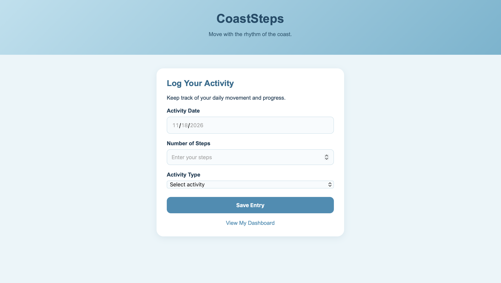
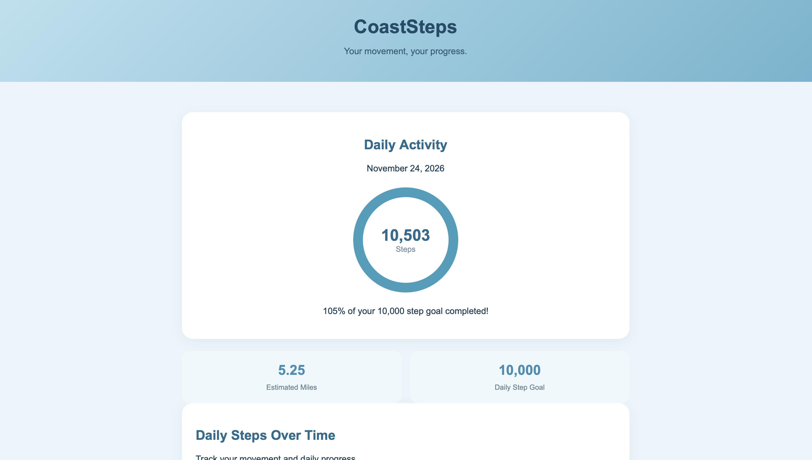
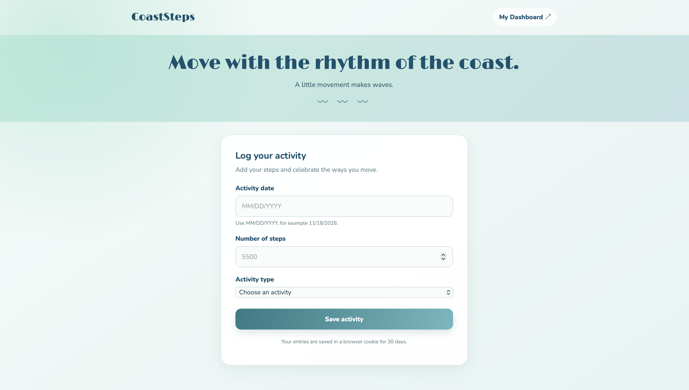
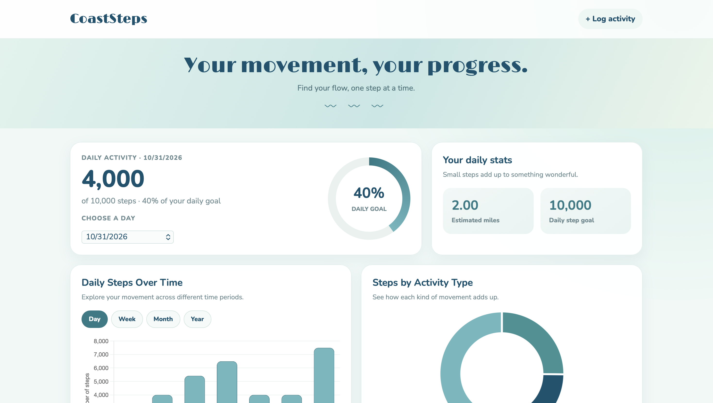
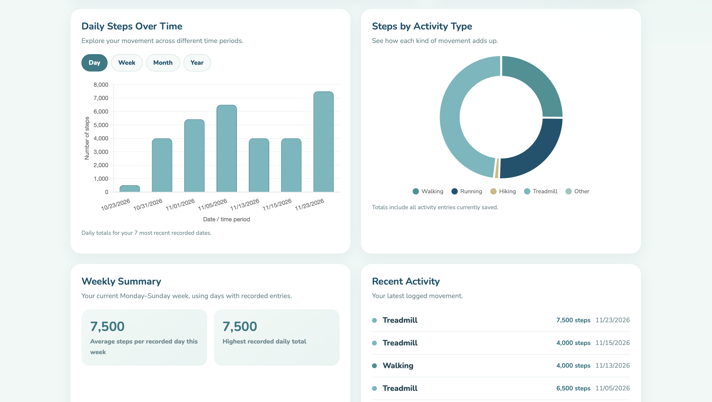
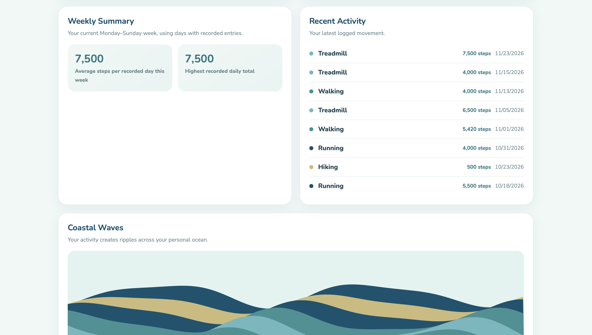
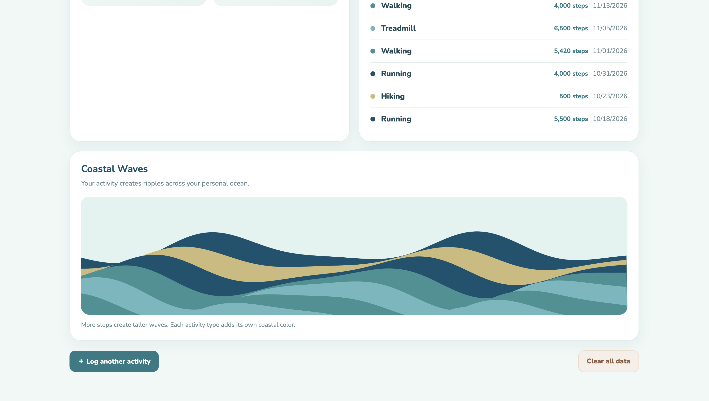

# CIM343Fall2026pt2
Part 2 of Front End Fundamentals Course Fall 2026

# Cookie Tracker – Daily Steps by Amanda & AI

🎥 **Video walkthrough:** <link>

## What I tracked and why
I decided to track daily steps because I've been recently trying to hit 10,000 steps each day and thought this would be a fun way to track my progress. I already use Apple Fitness to track my steps, but thought it would be fun to make a cuter more personalized tracker for me.

## Version 1 (prompt v1)
[Prompt v1](tracker-docs/prompt-v1.md)

Version 1 Data Form:

Version 1 Dashboard:

**What worked / what didn't:**
- When I add more than 10,000 steps for a daily entry, the percentage of my goal completed goes past 100% 
    - for example, if I add 10,500 steps, it says "105% of your 10,000 step goal has been completed!"
        - I want it to cap out at 100% instead

- The first chart (daily steps over time) displays the dates in YYYY-MM-DD fashion
    - I want it to be DD/MM/YYYY instead

- The 'recent activity' list does the same format with the dates, I want it also displayed in dd/mm/yyyy format

- I don't love how the 'daily steps over time' chart displays the weekly data, and right now the month and year buttons aren't changing the data layout correctly

- the entire visual I wanted (waves) was never included in the code

## Version 2 – Final (prompt v2)
[Prompt v2](tracker-docs/prompt-v2.md)

Version 2 Data Form: 

Version 2 Dashboard:
 
 

**Biggest change from v1 to v2, and why it helped:**
...

**Hand edits I made (if any):**
- Created a specific color & font scheme for the AI chat to follow

## How my code works (in my own words)

### Saving the cookie
(paste the part of your /tracker/v2 route that saves the entry, then explain it line by line:
how it uses req.cookies and res.cookie)

### Getting the data to the dashboard
(paste your dashboard route, then explain how it reads req.cookies and gets the data to the charts)

### Chart 1
(paste the code that builds `labels` and `data` from the cookie data, then explain it)

### p5 sketch
(which value controls size, color, position, etc.)

## Something the AI got wrong
...
